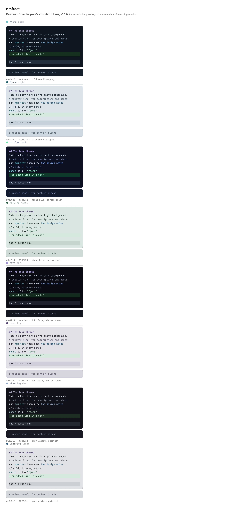
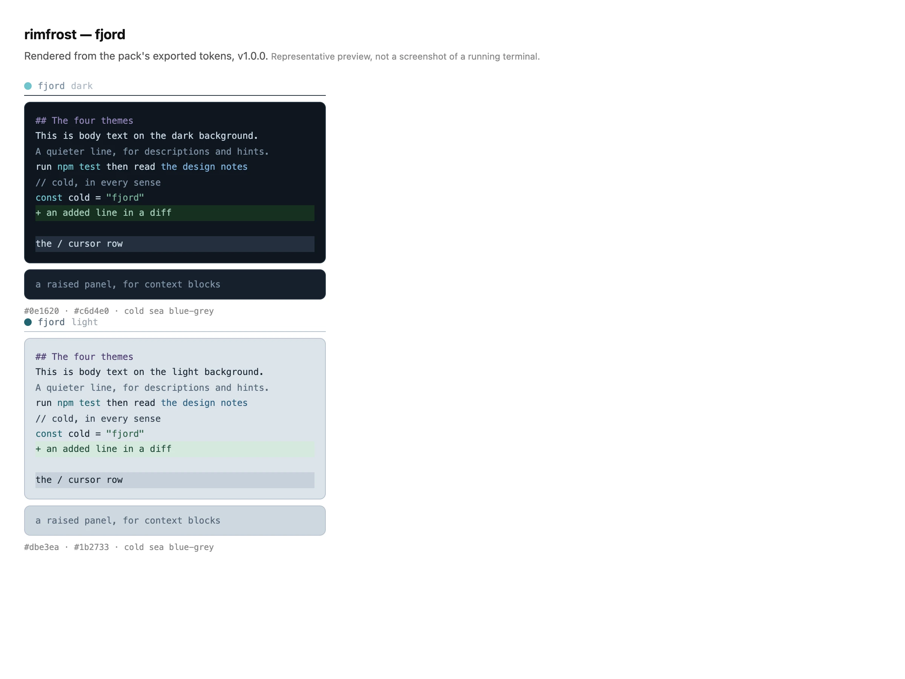
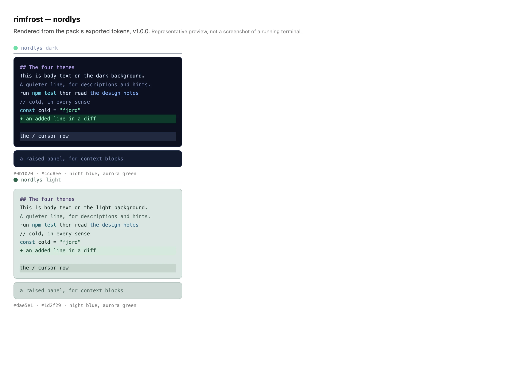
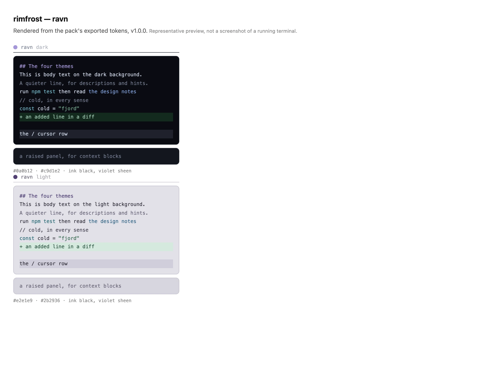
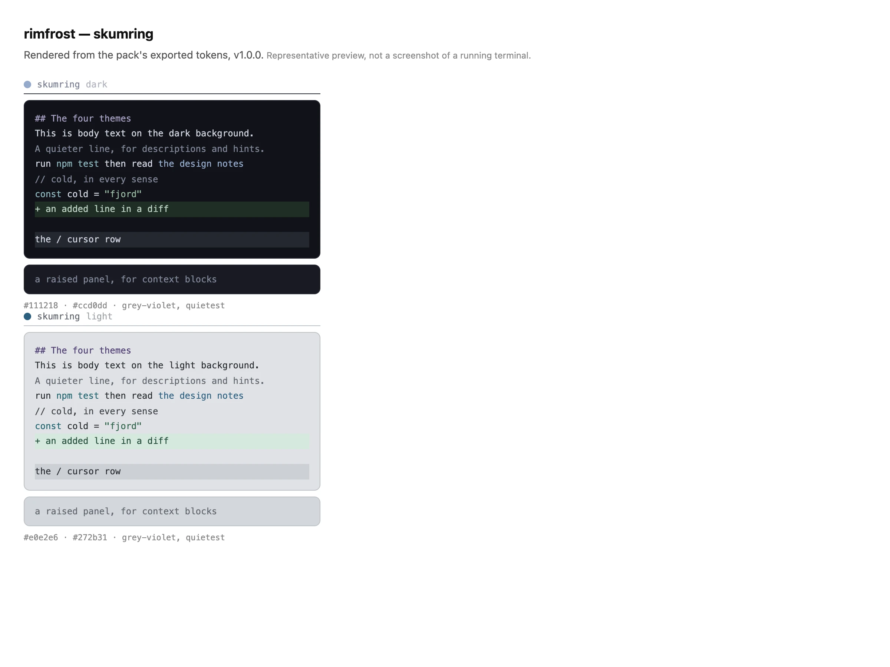

# Rimfrost

**Cold, not grey.**

An **unofficial** theme pack. One set of colours, exported for the tools you use —
[OpenCode](https://opencode.ai) theme JSON, [Ghostty](https://ghostty.org) sixteen-colour
palettes, and CSS custom properties for the web. Four Danish words — fjord, ravn, nordlys,
skumring — telling one day in one cold place, each with a dark mode and a light one.

Every target comes out of the same eleven ramps rather than being hand-made: OpenCode takes the
theme JSON, Ghostty takes the sixteen ANSI slots, a web page takes the CSS. More targets slot in
the same way.

Rimfrost is the frost that forms on a clear, still night. It needs open sky and no wind, which is
why the nights that grow it are the nights you see the aurora. The word is Danish; it is also
older than Danish, because English *rime* came out of Old Norse *hrím* and never changed.



*The previews below are rendered from the exported tokens, not captures of the running TUI.*

---

## Install

Every theme file is committed, so you can take one straight from this repo —
[`opencode/dist/fjord.json`](opencode/dist/fjord.json), [`ravn.json`](opencode/dist/ravn.json),
[`nordlys.json`](opencode/dist/nordlys.json), [`skumring.json`](opencode/dist/skumring.json) — or
from a clone. The **filename is the theme name**, so `fjord.json` becomes the theme `fjord`:

```sh
# for every project
cp opencode/dist/fjord.json ~/.config/opencode/themes/

# or for one project only
cp opencode/dist/fjord.json .opencode/themes/
```

Then pick it: `Ctrl+P` → **Open settings** → theme, or put it in `~/.config/opencode/cli.json`:

```jsonc
{
  "theme": { "name": "fjord" }
}
```

A theme file carries both modes. Follow your terminal, or lock one:

```jsonc
{ "theme": { "name": "fjord", "mode": "dark" } }   // "dark" | "light" | "system"
```

To try a mode without editing anything:

```sh
OPENCODE_CLI_CONFIG_CONTENT='{"theme":{"mode":"light"}}' opencode
```

If a theme you just added does not appear in the list, restart OpenCode — a new file has to be
discovered. Edits to an existing file reload live.

## Install in Ghostty

`npm run export` writes the sixteen-colour palettes into [`ghostty/dist/`](ghostty/dist), one
file per mode:

```sh
cp ghostty/dist/* ~/.config/ghostty/themes/
```

Then pick one, following your system's light and dark mode or locking a single file:

```ini
theme = light:Fjord Light,dark:Fjord
```

Terminals have no orange slot, so the pack's orange is the one colour that does not reach this
target. The palette is otherwise the same eleven ramps mapped onto the sixteen ANSI slots:
normal colours at step `300`, bright at `200` — which is *darker* in light mode, because the
ramps flip.

## Install in CSS

`npm run export` also writes CSS custom properties into [`web/dist/tokens/`](web/dist/tokens) —
one file per theme, plus a `tokens.json` holding every value for every theme and mode. Point a
stylesheet at one theme, or let a bundler pull it in:

```css
@import "web/dist/tokens/fjord.css";
```

One variable name is defined twice — once for dark, once under `[data-theme="<name>-light"]` — so
flipping a single attribute re-themes a page. Dark is also on `:root`, so a page that does
nothing still gets a complete theme. The eleven ramps come through in full (`--fjord-blue-500`)
beside the roles the themes use (`--fjord-text-base`).

```html
<body data-theme="fjord-light"> … </body>
```

Tailwind v4 and anything else that reads custom properties needs no further artifact. OpenCode's
interaction states (`$hovered`, `$focused`, …) are deliberately not exported — they are UI
behaviour, not colour.

## The four themes

One day in one cold place.

### fjord — daylight on cold water

Cold sea blue-grey with a teal accent. The flagship, built first, and the one that leans hardest
into blue.



### nordlys — the aurora

Night blue with the aurora burning green. The most saturated of the four.



### ravn — the dark hours

Ink black with a raven feather's violet sheen. The darkest.



### skumring — dusk, the light going

Grey-violet, barely any colour at all. The quietest and coldest.



Every theme has a daylight twin, **overcast**: a cool tinted sky rather than a white page, and
tinted per theme — fjord blue-grey, ravn violet, nordlys green-teal, skumring almost
colourless. That tint is the point: four light modes that are recognisably four different
days, instead of one washed-out grey repeated four times.

## The token model

Each theme is eleven colour ramps — `gray`, `red`, `orange`, `yellow`, `green`, `cyan`, `blue`,
`purple`, plus the aliases `accent`, `interactive` and `neutral` — with nine steps each
(`100`…`900`). Semantic roles (`text.base`, `markdown.heading`, `diff.background.added`, …)
reference those steps, so retuning one ramp moves everything that uses it.

Two things are worth knowing:

- **The steps flip between modes.** In dark mode `100` is the lightest step and `900` the
  darkest; in light mode it is the other way round. A role that names `gray.300` stays
  "roughly this light" in both modes because the ramp itself flips.
- **Contrast is checked, not eyeballed.** Body text is held to 4.5:1 and muted text, every
  syntax colour and every diff colour to 3:1, measured against all five surfaces they can land
  on. `npm test` fails if a palette drops below.

## Versioning

One version for the pack, in `package.json`, following SemVer as if the tokens were an API:

| bump | when |
|---|---|
| **major** | a token or theme is removed or renamed, or an existing token changes meaning |
| **minor** | a new theme, a new exported token, or a new output format |
| **patch** | a colour retune, tests, docs |

**A colour change is a patch.** Consumers bind to token names, not to exact hex, so retuning
`--fjord-blue-500` does not break anyone. Changes are listed in [CHANGELOG.md](CHANGELOG.md).

## How the palettes are defined

`src/palettes/<theme>.mjs` is data, not code: five anchors per ramp per mode
(`100/300/500/700/900`), and the four steps in between are interpolated in OKLab so the ramp
keeps its hue instead of drifting through grey. Everything else in the file is bindings.

```
opencode/            the OpenCode target — dist/<name>.json
ghostty/             the Ghostty target — dist/<Name>, dist/<Name> Light
web/                 the web target — dist/tokens/, dist/preview/
src/
  contract.mjs       the token tree and the value rules
  color.mjs          sRGB ↔ OKLab, WCAG contrast
  ramp.mjs           five anchors → nine steps
  theme.mjs          a palette spec → a complete theme file
  validate.mjs       completeness, ramp direction, the contrast matrix
  build.mjs          validate, write opencode/dist/<name>.json, --install
  export.mjs         write opencode/dist/ and web/dist/tokens/
  export-ghostty.mjs opencode/dist/ → ghostty/dist/
  palettes/          the four themes — one file each
tools/               dev-only: preview renderer, loader check
test/                node:test, palette-agnostic
docs/reference/      the extracted OpenCode theme contract
```

Building from source needs Node 20.19+ and nothing else — there are no dependencies:

```sh
npm run build                  # validate and write opencode/dist/<name>.json
node src/build.mjs --install   # …and copy to ~/.config/opencode/themes/
npm test                       # the whole suite: values, ramps, contrast, every target
npm run export                 # opencode/dist/, ghostty/dist/ and web/dist/tokens/
npm run preview                # web/dist/preview/
```

## How it was built

The theme format is not documented anywhere machine-readable, so the contract was extracted
from the OpenCode binary itself: the token tree, the value rules and the loader's own resolver,
which `npm run check:loader` replays against the built files — the only check that proves a
theme actually loads. Every palette was then designed by hand, from approved anchor colours, and
held to the contrast floors above.

## Licence

[MIT](LICENSE). Everything under `opencode/dist/`, `ghostty/dist/` and `web/dist/` is yours to use however you like.

Not affiliated with, endorsed by, or part of the OpenCode project.
